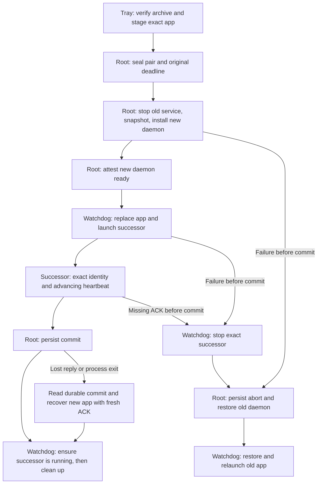

# Release Policy

Slipstream publishes three distinct kinds of GitHub release. Their tags and
purpose must remain visually and mechanically separate.

| Kind | Tag | GitHub state | Purpose |
|---|---|---|---|
| Stable app | `vX.Y.Z` | Release and latest | Signed updater feed and first installation |
| Preview app | `vX.Y.Z-preview.N` | Pre-release, never latest | Qualified build from `main`; use the DMG while public auto-update remains unverified |
| Geph dependency | `geph-vendor-X.Y.Z-rN` | Internal pre-release, never latest | Reviewed and attested build input, not an app release |

Preview and internal dependency releases never replace GitHub's latest pointer
or the stable updater feed. Old tags are retained as build history and never
moved; user-facing installation instructions always select the newest
compatible app release.

`v0.1.9-preview.23` is the first preview with signed background discovery of
new preview releases. Existing `.22` installations require one manual `.23`
installation because `.22` reported the stable-looking package version `0.1.9`
and cannot safely compare it with the new prerelease version. From `.23`
onward, discovery may post a native notification, but download, installation
and relaunch require an explicit tray-menu action. Publish `.24` after the
existing exact-candidate CI, dependency-audit, packaged/native, protected
readiness and publisher verification gates pass. Then qualify the first real
public `.23 -> .24` upgrade and forced rollback against the immutable published
assets. This post-publication gate must prove notification identity/submission,
the bounded signed install, successor health, rollback on failure, and no Dock
tile, window or focus change. Until it passes, release notes and user-facing
claims must describe preview auto-update and public upgrade/rollback as
unverified. Local MockRuntime tests are updater mechanics evidence only and do
not satisfy this live gate. No other publication requirement changes.

The 2026-10-15 public `.23 -> .24` attempt stopped before installation: the
GitHub releases listing exceeded the released client's per-page byte limit.
The pagination repair in source is not present in either published binary.
Keep both releases' signed assets unchanged and use the DMG for this transition.
Public success, forced rollback and the separate daemon-identity acknowledgement
boundary remain open; no source-only or modified-old-client test closes them.

Root READMEs link to the releases list and instruct users to select the newest
Slipstream app release, excluding internal dependency releases. Keep installation
instructions version-independent; do not use GitHub's latest pointer for previews.
Describe preview limitations without presenting unpublished repository fixes as
capabilities of the downloadable build.

The `.23` installer itself is transactional. After signature and bundle
validation, a separately signed non-AppKit watchdog durably records a
same-volume staged app and verified sibling backup before replacement. It
accepts the successor only when exact path, version, process identity, tray
startup, owned daemon, and advancing heartbeat agree. The published daemon
identity check is incomplete: source now requires bundled-daemon attestation and
the same PID across fresh advancing heartbeat observations. A pending successor
with a mismatched daemon refuses startup without spawning a privileged installer;
the watchdog restores the previous application. Coordinated replacement of both
daemon and app is implemented in source; native and public qualification remain
open.
In updated clients, a restored rollback app also waits for the watchdog's lock,
terminal cleanup and exact old-app receipt before resuming daemon installation.
It emits no successor ACK. Existing published clients retain their old behavior.
The journal and user LaunchAgent are owner-private,
restart-safe, and removed only after a terminal acknowledgement or recorded
rollback; neither path uses `open` or activates the app.

After a preview is published and its remote tag, state, identity, asset set and
digests are verified, the immediately preceding preview is marked as archival
in its release title. That presentation-only edit is idempotent and its exact
remote result is required. If publication succeeds but this final edit fails,
a rerun may resume only the already-published release whose ID, tag, source
commit, channel, name, local artifacts, remote asset set and digests all match;
it then retries the archival finalizer without rebuilding or replacing files.
Drafts, tag-only collisions and mismatched publications remain fail-closed. The
previous tag and verified artifacts remain unchanged.

## Coordinated app and daemon update qualification

The coordinated implementation merged in PR393. It is not in
preview `.24`, and the evidence for PR392 covers the refusal/rollback guard,
not this new protocol. The supported updater must already be present in the
originating app and root daemon; a successor cannot repair an older watchdog
that was copied before replacement. Existing `.23` and `.24` users therefore
need a manual DMG or separately qualified bridge transition.

The protocol orders effects as follows. The root worker's durable decision
controls recovery; a missing reply is not evidence that an operation stopped.

| Boundary | Required evidence before proceeding | Failure behavior |
|---|---|---|
| Prepare | Signed archive, fixed target, exact old/new app and daemon identities, retained full bundles, recoverable root worker | Retain uncertain authorization state; never delete data a late authorized worker could still use. |
| Activate daemon | Old service quiesced and saved, new frozen payload installed, fresh owned runtime attestation | Restore the exact old runtime and verify it before app rollback. |
| Activate app | Root reports the exact new daemon ready | Move the old app to its verified backup, then launch the successor. |
| Acknowledge | Exact successor identity and tray startup, same owned daemon PID with advancing heartbeat | Stop the exact successor and request abort. |
| Commit | Root commit is durable and confirmed | Finish the new generation even if a reply or watchdog is lost. |
| Abort | Root reports restored old runtime and no privileged writers remain | Only then restore and relaunch the old app. Unproven restoration remains an explicit recovery error. |



The two journals have different owners. The app journal records app replacement
and the last requested root action; the root journal alone decides commit or
abort. An unknown authorization outcome retains the original operation identity
for an explicit retry. Retry does not renew its deadline. A committed root
decision requires recovery of the new app, including a fresh acknowledgement
after relaunch; it cannot authorize restoration of the old app.

If the selected daemon restarts after that decision, a stale runtime proof
causes the app to request a rate-limited mailbox wake. The retained root worker
refreshes the proof for the same selected payload without replaying an action
or reinstalling a runtime. It exits after that attempt; normal heartbeats do
not wake it. The consumer records its 330-second retry window in the private
transaction mailbox, so automatic watchdog restarts cannot renew that window.
Only a newly verified daemon process generation starts another episode; a
missing heartbeat does not reset it. Exhaustion retains the transaction guard
and reports the recovery failure. A fresh proof remains mandatory before app
recovery can finish.

An installation attestation records the service's health at installation time.
A healthy transition between `dormant` and `active` on the same process must not
invalidate that receipt. Runtime proof validates both historical and current
health pairs, compares every other identity field, and independently checks
current process, listener, witness and PF evidence. It never rewrites the
installation receipt to conceal drift. A preparation refusal before publication
keeps exit code `77` and `daemon_update_no_operation`; an additional bounded
`daemon_update_stage` symbol identifies the failing phase without logging
exception text, paths, credentials or transaction identity.

| Code owner | Responsibility | Useful failure boundary |
|---|---|---|
| [`lib.rs`](../app-tauri/src-tauri/src/lib.rs), `authorize_daemon_update` | Administrator authorization and guarded tray controls | Rejected authorization versus an uncertain privileged outcome |
| [`updater_transaction.rs`](../app-tauri/src-tauri/src/updater_transaction.rs), `prepare_transaction`, `run_locked_watchdog` | Durable app journal, renames, exact successor process and recovery | Root readiness before rename; root decision before cleanup or rollback |
| [`daemon_update.rs`](../app-tauri/src-tauri/src/daemon_update.rs), `Client`, `Status` | Strict cross-process messages and fresh daemon evidence | A receipt from another operation, version, PID or expired preparation |
| [`tproxy.py`](../spike/tproxy.py), `do_update_prepare`, `_daemon_update_worker_loop` | Sealed root runtime, installer lock, service snapshot and durable decision | Worker restart, late request, failed install or incomplete restoration |

Use two normally built, source-bound CI artifacts on disposable macOS: a bridge
with this protocol and a successor with a normal version bump. The bump must
change the compiled app version and frozen daemon bytes. Do not manufacture the
pair by editing only `Info.plist`, repacking the same daemon, modifying a public
release, or installing the successor daemon before triggering the update.

The initial app handoff releases its transaction lock before bootstrapping the
watchdog: a RunAtLoad helper may start before `launchctl` returns. LaunchAgent
publication and retirement of the previous registration remain under the lock.
If publication or bootstrap fails, durable Prepared evidence and the original
root lease remain available to the existing recovery path. Once the lock has
been released, the preparer never cancels using its stale journal snapshot.

Qualification must observe the real installed daemon identity, fresh PID and
attestation on success and forced rollback, and inject failures before/after
runtime replacement and durable commit. App and watchdog exit before/after ACK
must converge to that same durable decision. Hermetic state-machine tests and a
CI driver that directly invokes the transaction are useful protocol evidence;
they do not establish public discovery, tray activation, or released-pair
compatibility. Preserve those distinctions in the result and release notes.

### Native root decision gate

The dispatch-only [native root update workflow](../.github/workflows/native-root-update-qualification.yml)
runs two cases on separate disposable macOS runners. `commit` installs the old
runtime, activates the successor, verifies its live identity and commits.
`crash-before-commit` stops the exact update-worker launchd job after readiness,
requires restoration of the old runtime, then sends a late commit and verifies
that the mailbox wake preserves the abort decision. It never preinstalls the
successor or uses `kickstart` to manufacture the terminal wake.

Provide two successful main CI `release-candidate-<source SHA>` artifacts.
Each side is pinned by run ID, attempt, full source SHA and candidate-manifest
SHA256. [Materialization](../scripts/materialize_pair.py) verifies those pins,
GitHub attestation and all manifest files before extracting either app. The
[driver](../scripts/native_root_update.py) checks the pair again before the first
install. Different versions, tray executables and daemon bytes are mandatory.
The first PR393/PR394 pair failed before installation because the bundled Geph
executable had mode `0700`. Keep that evidence; do not repair signed archives in
place. Build a fresh bridge with corrected packaging and a normal version-bumped
successor. Both must pass the existing updater artifact verifier, including
root-readable file/directory modes and console-executable entry points. The
same mode check runs on the built app tree before candidate assembly. The public `.24` assets
are unchanged. Use retained candidates within the existing 14-day artifact window.

The driver has a 720-second total budget including preparation and teardown;
the production authorization lease remains 300 seconds. Both cases uninstall
through the ordinary installed command and verify owned service, worker and
retained-state cleanup. Result JSON contains source/payload identities, bounded
observations and cleanup failures. A separate outcome JSON is uploaded even if
checkout, dependencies or download fail. No Geph account is required.

These cases qualify the native root protocol only. App renames, successor ACK,
watchdog recovery, administrator dialogs, public discovery and an actual released
update pair still need their own existing evidence. A passing root case must
not be reported as a passing public auto-update.

## Legacy App Releases

`v0.1.1` through `v0.1.4` predate the current channel policy and the private PF
anchor. They remain immutable, non-prerelease GitHub releases so the legacy
updater endpoint at `releases/latest/download/latest.json` continues to resolve
until a qualified stable release replaces it. GitHub may therefore label
`v0.1.4` as **Latest** even though its title and release notes mark it as an
archival build.

These legacy releases are not used for a new installation. The root README
points new users to the newest non-archival Slipstream preview. Do not delete,
retag, or convert the legacy releases to prereleases merely to change their
presentation: doing so would also change the updater endpoint.

## App Artifacts

| File | Purpose |
|---|---|
| `Slipstream_*.dmg` | Primary first-install format for macOS Apple Silicon |
| `Slipstream-macos-arm64.zip` | Alternative first-install archive |
| `Slipstream.app.tar.gz` | Tauri updater archive |
| `Slipstream.app.tar.gz.sig` | Tauri updater signature |
| `latest.json` | Tauri updater index |
| `artifact-manifest.json` | Target, source commit, byte size, and SHA-256 for every release payload asset |
| `release-candidate-manifest.json` | Exact-main CI run, source Git tree/archive digest, and every immutable candidate file digest |
| `release-qualification.json` | Protected owned-Geph and deterministic semantic result bound to the exact candidate and combined readiness workflow attempt |
| `release-readiness.json` | Protected Safari/Chrome live-origin and measured 30-minute invisibility results bound to the same exact candidate and workflow attempt |
| `transport-mechanics.json` | Protected exact-candidate dual-stack listener/PF evidence, Darwin IPv4/IPv6 NATLOOK test-port transaction, and deterministic encrypted QUIC v1/v2 mechanics; it does not claim a live origin's negotiated protocol or address family |
| `Slipstream.spdx.json` | Deterministic SPDX 2.3 inventory for the resolved `aarch64-apple-darwin` graph, pinned runtime locks, and top-level vendored components |
| `dependency-audit.json` | Source-, target-, SBOM-, policy-, and scanner-bound vulnerability audit result |

Stable releases additionally carry the signed route-policy bundle, channel
index, and public trust keys. Preview releases must not contain those assets.

The manifest and SBOM use the source commit timestamp rather than workflow wall
clock time. Release verification rejects missing, empty, unexpected, symlinked,
or modified files before publication. The macOS build target is explicitly
`aarch64-apple-darwin`.

Updater verification is additionally cryptographic and offline. Before
publication, `verify_updater_artifacts.py` verifies the exact updater archive's
minisign signature with the public key from the source-bound Tauri
configuration, confirms that the same key is compiled into the packaged main
executable, and inspects the signed tar without extracting it. The archive must
contain one `Slipstream.app` made only of regular files, directories and safe
relative links that remain inside that app, the expected bundle
identifier and executable, the exact release version in both version fields,
and `LSUIElement=true`. Path traversal, absolute or app-escaping links,
duplicate entries, unsupported types, decompression-size excess, a wrong key,
a replayed signed archive from a different version, or any byte change fail
publication. The verifier emits the archive, signature, configuration,
executable and updater-key hashes in the existing publisher report; no
Cargo/Tauri build or network call is permitted.

## Dependency Audit

Pull requests, `main`, a weekly scheduled run, and every app release scan the
target-specific SPDX inventory with a checksum-pinned OSV Scanner. The reviewed
policy in [`../security/dependency-audit-policy.json`](../security/dependency-audit-policy.json)
records informational advisories, blocks every unreviewed vulnerability, and
allows only exact package/version/advisory exceptions with an expiry date.
Scanner failures and empty inventories fail closed.

OSV Scanner 2.3.8 does not emit an ecosystem for SPDX `pkg:generic` packages.
The application policy therefore has a separate optional integrity-only list:
an incomplete scanner row is accepted only without vulnerabilities and only
when its exact name/version matches one unexpired policy entry and the SBOM has
the same exact generic purl and SHA-256. Reports count scanner-covered and
integrity-only packages separately; their sum must equal the full SBOM. Every
other incomplete row still fails closed. Geph schema-v1 reports contain no
integrity-only section and remain valid.

The published report is part of `artifact-manifest.json`, and release
verification recomputes its SBOM and policy hashes. The application inventory
lists Geph and `tg-ws-proxy` as top-level vendored applications. Geph
additionally has its own reviewed source contract, `Cargo.lock`, full
transitive SPDX inventory, and fail-closed audit in the `geph-vendor-*-r*` release.
Before embedding it, the app workflow requires an exact published internal
prerelease, resolves its lightweight tag ref to one commit, and downloads the
complete fixed asset set. It checks the strict `SHA256SUMS`, requires the
release source, lock, version, and license to be byte-identical to the reviewed
tree, verifies the release SPDX and audit against the policy stored at that
tag commit, and verifies SLSA provenance for every asset plus the binary's SPDX
attestation. The separately required dependency audit freshly scans the current
full Geph graph and policy so newly published advisories and expired exceptions
still block a later app release.
`tg-ws-proxy` remains covered by its separate vendored-source review rather
than a Rust dependency graph.

An exception never changes an immutable Geph release in place. If a fix is
lock-compatible, the reviewed lock digest and `release_revision` are bumped and
a new `geph-vendor-X.Y.Z-rN` is built and attested after that change reaches
`main`. The temporary h2 0.4.15 exception for Geph r1 exists only to let the P0
source merge; it expires on 2026-08-27 and does not authorize publishing
`v0.1.9-preview.23`. The release candidate must embed the reviewed and attested
`geph-vendor-0.3.9-r1`, whose lock uses fixed h2 0.4.17. The separate exact h2
0.3.27 exception documents the residual low-severity availability risk in
Geph's Hyper 0.14 AWS client until upstream provides a fixed 0.3-compatible
graph.

## Geph Dependency Artifacts

| File | Purpose |
|---|---|
| `geph5-client` | Universal macOS binary built from the reviewed lock |
| `geph5-client.SOURCE.json` | Exact crates.io URL, SHA-256, features, targets, and lock digest |
| `geph5-client.Cargo.lock` | Complete reviewed Rust dependency graph |
| `geph5-client.spdx.json` | Deterministic SPDX 2.3 inventory for both macOS architectures |
| `geph5-client-dependency-audit.json` | Full-coverage, policy-bound vulnerability result |
| `geph5-client.LICENSE` | MPL-2.0 text |
| `geph5-client.VERSION` | Exact embedded dependency version |
| `SHA256SUMS` | SHA-256 for every Geph dependency asset |

A new upstream Geph crate cannot publish a binary immediately. Automation first
opens a source-contract PR; only the reviewed and merged contract may trigger a
locked build.

That source-contract PR requires Geph `SOURCE.json` and `Cargo.lock`. It may
also apply the exact reviewed RUSTSEC-2026-0285 application lock transition:
rustls0.23.41->0.23.45 and rustls-webpki0.103.13->0.103.15 with their pinned
checksums. The classifier reads both lockfiles from exact base/head Git SHAs and
requires the parsed graph and metadata to remain otherwise identical. Missing
proof or any other lock change requires ordinary packaged checks. Separate
merges would each fail the audit of the other unfixed graph. Optional paths are Geph `VERSION` and its audit policy, the exact
release/decision/checkpoint documents, and the scope classifier with its test
file (classifier changes without the test file are rejected). The Geph publisher
workflow may accompany its build-contract tests when repairing source publication
ordering. Application source, Cargo manifests, application audit policy,
packaging scripts, and all other workflows are not allowed in this scope.

Common product and Chromium checks still run. The separately required
`Required dependency audit` context must freshly scan **both** dependency graphs;
no advisory is waived. Only packaged app jobs stay skipped because the new
immutable Geph binary cannot exist yet. A production-code PR cannot use this
scope, and a push to `main` never uses it. After reviewed merge, `build-geph`
builds and attests the new internal release; the first main app run may fail
closed while that artifact is absent and is rerun only after publication. The
rerun then builds and qualifies one candidate from the same source SHA and new
exact Geph artifact before any application release.

Scope classification runs reviewed repository code, as do the workflow and its
tests. Exact byte bindings detect an unintended dependency transition; they are
not a security boundary against a malicious edit to the classifier or workflow
itself. Such edits require code review. A self-hash checked by that same mutable
classifier would not establish an independent trust boundary.

The Geph synthetic runner isolates execution of the allowlisted test binary.
Compilation, including Cargo build scripts and procedural macros, remains part
of the existing trusted build phase, just like the subsequent locked binary
build. The runtime sandbox is not a claim that compilation is isolated.

On a main push, the Geph publisher builds the verified committed source contract,
including maintenance revisions older than the latest upstream crate. Scheduled
discovery still proposes the latest upstream version for separate review. A manual
`build_reviewed=true` dispatch uses the same reviewed-main path and refuses other
refs. It does not bypass lock, archive, audit, attestation, or immutable-tag checks.

## Candidate and publication pipeline

- Required exact-main CI builds the frozen daemon, app, updater archives and
  pinned headless shell once, then assembles and attests one immutable
  `release-candidate-${SHA}`. Packaged lifecycle, browser, and native-update
  notification qualifications consume independent copies of that candidate in
  parallel; none rebuilds it. The candidate is eligible for protected
  qualification only when the entire required CI run, including all three
  consumers, succeeds. Pull requests use an equivalent sealed local-build
  bundle because updater signing secrets are unavailable there.
- The main-only update-notification consumer runs the exact candidate from its
  production `/Applications/Slipstream.app` layout on a disposable macOS host.
  The production `UNUserNotificationCenter` path must obtain promptless
  provisional or existing authorization, submit one capability-derived request,
  observe exactly that identifier through the supported delivered-notification
  API, remove only that test request, and leave no Dock, window, activation,
  frontmost-app, process, or registration residue. Permission denial verifies
  fallback behavior but cannot authorize a release that claims notifications
  work. Private notification databases remain secondary diagnostics only.
- The candidate tree digest includes every directory, symlink, regular file,
  mode, relative path, and file payload. Legitimate zero-length marker files
  inside the packaged application are represented in that digest; top-level
  release and candidate artifacts remain strictly nonempty.
- JavaScript dependencies are installed with lifecycle scripts disabled and no
  production updater credential. Compilation and bundling use a disposable CI
  updater key. A separate no-checkout, no-repository-code signer job first
  verifies the frozen archive and pinned Tauri CLI tarball digests, then exposes
  the production key only to the signing command. A no-secret assembly job
  binds both GitHub service-artifact digests and reruns the offline updater
  verifier before candidate assembly. OIDC and attestation permissions live in
  another no-checkout, no-shell-command job that downloads the sealed
  candidate; build, signer, and assembly jobs do not inherit them.
- One protected release-readiness run downloads that exact artifact, verifies
  its source commit, Git tree, source-archive digest, CI run ID and file hashes,
  then holds one account-backed owned-Geph lifecycle across the deterministic
  Chromium semantic scenarios and fixed Safari/Chrome live-site matrix. After
  exact Geph, browser, daemon, PF, Keychain, and user-state cleanup it runs the
  measured invisibility soak. Separate qualification and readiness proofs bind
  both result sets to the same candidate manifest and protected run attempt;
  the workflow does not rebuild the app.
- A Linux preflight with only the read-scoped ephemeral GitHub token and no
  protected account/broker secret limits `release-readiness` and the standalone
  diagnostic-only owned-Geph workflow to three fresh `main` dispatches combined
  per UTC day. It counts every outcome, rejects workflow reruns, and fails closed
  on incomplete API evidence; a fourth dispatch stops before the protected
  environment, candidate download, broker authentication, or the measured soak.
  This budget does not justify retrying unchanged failures or omitting any
  release gate. The shared `queue: max` concurrency group serializes retained
  dispatches without silently replacing an older pending slot. GitHub reruns
  use the source of the original run, so historical
  runs created before this guard must never be rerun; repository code cannot
  retrofit their old workflow definition without a protected-environment secret
  rotation. A dispatch still queued when the UTC broker day changes fails the
  new-day preflight and must be dispatched fresh after the reset.
- A manual `build-app` run creates the next explicitly validated preview only
  from `main`; the accepted tag is exactly `v0.1.9-preview.24`, with
  `VERSION` and `preview_sequence=24` matching that version. The historical
  `release_source_commit` repair override remains restricted to the pinned
  `.23` source and is rejected for `.24`; the new preview requires its own
  exact-source candidate and qualification evidence.
  A draft, tag-only collision or mismatched published
  release with that exact tag name fails closed. The sole exception is an exact
  already-published release left by this transaction: after the complete local
  and remote identity/digest proof, it may resume the idempotent post-publication
  finalizer.
  It verifies the exact successful main-CI, dependency-audit, and combined
  protected release-readiness run. The audit run must belong to
  the same repository, main push, source SHA and workflow path, and its
  application audit, full Geph-vendor audit, and required aggregator must each
  have completed successfully; a skipped leaf cannot authorize publication.
  The publisher then verifies the stored attestations and creates only
  `latest.json`, the public artifact manifest and release notes. It uploads the
  unchanged candidate into one exact draft with replacement disabled, verifies
  that draft ID plus every remote asset size and SHA-256 against the local
  manifest, and only then publishes that exact ID. A final API read must prove
  the lightweight tag points to the source commit, the release is non-draft and
  has the expected prerelease/name identity, and the unique remote asset set
  still matches every digest. A failed or lost publish API response is
  inconclusive: this authoritative read, rather than the response, decides the
  result. PyInstaller, Cargo/Tauri build and every qualification are prohibited
  in the publisher.
- The current workflow is preview-only. A pushed `v*` tag stops before checkout
  until Developer ID signing, hardened runtime, notarization, and stapling are
  implemented as a fail-closed stable-channel gate.
- Once that gate exists, a pushed tag exactly matching `v$(cat VERSION)` may
  create a stable release.
- The exact packaged app must pass disposable-CI lifecycle and protected
  account-backed qualification before either channel is published. Production
  browser recovery uses its bundled pinned headless shell, never LaunchServices
  or the user's installed browser. Final live-site Safari/Chrome and idle-soak
  checks run against the exact downloaded candidate artifact.
- Stable publication also requires the reviewed signing and route-policy
  secrets. Developer ID notarization and stapling remain a stable-channel gate.
- Release notes contain a short artifact/channel preface followed by GitHub's
  generated list of merged changes.
- Branch protection retains the exact public contexts `checks` and
  `packaged-app-lifecycle`. Their lightweight aggregators always run: a
  documentation-only change validates continuity, links, and the actual Git
  diff without invoking product builds; Windows jobs run only for Windows or
  shared-adapter paths. Product builds publish one reusable candidate so a
  failed qualification can be retried without rebuilding.

Warm performance targets are six minutes for build plus parallel qualification
without soak, two minutes for promotion of an already qualified candidate, and
three minutes for retrying one failed consumer without rebuilding. Timing is a
measured release gate, not inferred from workflow structure.

## Attestations

After exact-main candidate packaging passes browser and lifecycle verification,
GitHub Actions signs two attestations with its short-lived OIDC identity:

- SLSA provenance covers every file in the verified release payload;
- the SPDX 2.3 inventory is attached to the ZIP, updater archive, and DMG.

Both attestations are stored in GitHub's attestation service. The publisher
verifies them against the exact source commit, the `ci.yml` signer, and a
GitHub-hosted runner before publishing the release. The combined protected
release-readiness workflow separately attests `release-qualification.json` and
its live/soak reports, `transport-mechanics.json`, and manifest-bound readiness
proof. The publisher requires both proof artifacts to name the same protected
workflow run and attempt and verifies that signer plus the exact candidate
manifest before publication. A downloaded artifact can
be checked independently:

```bash
gh attestation verify Slipstream-macos-arm64.zip \
  --repo aiwaki/slipstream \
  --signer-workflow aiwaki/slipstream/.github/workflows/ci.yml

gh attestation verify Slipstream-macos-arm64.zip \
  --repo aiwaki/slipstream \
  --signer-workflow aiwaki/slipstream/.github/workflows/ci.yml \
  --predicate-type https://spdx.dev/Document/v2.3
```

Do not repurpose or move an existing release tag. A corrected artifact requires
a new preview tag or a new patch version.
