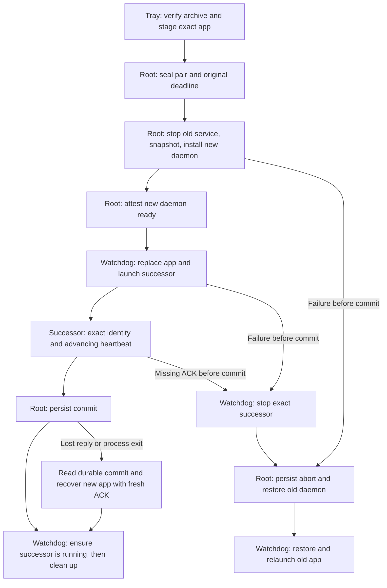

# Release Policy

## Workstation update failure and .31 restoration — 2026-11-05

The ordinary `.31 -> .34` menu attempt on the user's Mac did not complete.
The installed app remained `.31`. The root updater chose abort after activation
but could not finish recovery, so launchd repeatedly restarted the same worker.
The main owned daemon was absent; retained PID and heartbeat fields in the root
transaction were not evidence of a running service.
Authorized private-journal inspection proved activation began, the runtime
snapshot was never created, and the original .31 daemon bytes remain intact.
A subsequent read-only kernel query found no PF starter references at all,
although Slipstream still retained its old token and PF remained enabled. The
old stop path treats release of that nonexistent reference as incomplete cleanup.
What invalidated the reference is not established. No new install, service
mutation or retry was initiated during the diagnostics.
Evidence: `output/continuation-20261101/preview34-release/post-stall-main-a0a60e080/public-update34/workstation-check-20261105/read-only-verification.json`.

The independently accepted public `.33 -> .34` update and pre-ACK rollback
remain evidence for that tested pair; they do not qualify this failed `.31`
workstation transition. The .34 workstation update, browser and Quit verification
are still open. Preserve the failed operation's diagnostic evidence.
The local stopped-writer/empty-reference fix passed128 focused stop/adapter
tests and160 updater/PF regressions. It is not in published .34 or installed .31.
The first PR464 revision also passed native source and packaged-app lifecycle
checks in CI42014542528/1, including real invalid-token rejection, ordinary stop
and an unchanged PF snapshot. A follow-up explicitly excludes unlocked foreground
cleanup; its130 stop/adapter and138 updater/lock tests pass, with native CI pending.
The separate one-operation receipt repair passed8 isolated fixtures. After the
user explicitly approved .31 restoration, it ran once with administrator
authorization, saved the proven stale token privately, and removed only that
receipt. The already-running abort completed; no new update was started.

At 09:28:35 UTC, `workstation-check-20261105/recovery-acceptance.json` recorded
RESTORED_PREVIEW31 with all16 checks true: old app/daemon hashes and versions,
running app and service, fresh active StatusV2 with an advancing heartbeat on
the same PID, terminal quiescent abort, and both updater workers exited0.
The existing recovery cleaned the app journal and stage/backup transaction slots.
The saved .31 ZIP and verified .34 archive remain; external Geph process
identities are unchanged. Settings and learning were not changed. This proves
restoration, not a successful .34 update or browser/media/Quit qualification.

## Preview .34 in preparation — 2026-11-01

The next candidate combines the shared Geph recovery lifetime repair in
[PR #453](https://github.com/aiwaki/slipstream/pull/453) with restart reservation
cleanup in [PR #454](https://github.com/aiwaki/slipstream/pull/454). Caller
cancellation no longer owns or poisons the shared recovery result; an exception
while observing a restarted process releases the owned reservation instead of
refusing later sessions indefinitely. Both changes have causal regression tests
and passed their required PR checks. They are not in published `.33`.

Prepare an ordinary `.34` candidate and qualify the exact `.33 -> .34` pair.
The old release's G/P/R and public-update results remain evidence for its original
bytes. The successor needs fresh exact-candidate gates and current admission.
Geph 0.4.3-r4 remains unchanged. Add the new public observer only after publication
provides its real release and asset identities; preserve the `.32 -> .33`
observer and evidence. No new candidate, publication or user-Mac verification is
claimed by this preparation.

## Published preview .33 — 2026-11-01

[Slipstream 0.1.9-preview.33](https://github.com/aiwaki/slipstream/releases/tag/v0.1.9-preview.33)
was published from `9eccd1ddf691aef5f76d493103513f2fada2fd5c` by
[publisher 41309441046/1](https://github.com/aiwaki/slipstream/actions/runs/41309441046).
The pre-release includes scoped recovery ownership, incomplete DNS,
accepted-client cleanup and lazy worker shutdown repairs, plus Telegram
transport 1.11.2. Geph 0.4.3-r4 and the stable release are unchanged.

**RU:** Выпуск исправляет отдельные ошибки отмены запросов, обработки неполных
DNS-ответов и остановки обработчиков. Недоступность Geph до начала соединения
больше не учитывается как ошибка уже выполненной попытки. Telegram transport
обновлён до 1.11.2. В CI проверены четыре сайта в Safari и Chrome, остановка и
восстановление Geph, установка пакета и откат при завершении новой версии до
подтверждения запуска. Наблюдение в течение 1800,12 секунды проверяло работу в
фоне и очистку, а не непрерывное видео или звонок. Обычный публичный переход
`.32 → .33` через меню, включая отмену и повторную установку, подтверждён.
Отдельно подтверждён аварийный возврат к `.32` при завершении `.33` до
подтверждения запуска. Установка на пользовательском Mac пока не проверена.

**EN:** This release repairs scoped request-cancellation, incomplete DNS response
and worker-shutdown failures. Geph unavailability before a connection attempt
is no longer counted as a failed dial. Telegram transport is updated to 1.11.2.
CI covered four sites in Safari and Chrome, Geph stop/recovery, package update
and rollback after terminating the successor before its startup acknowledgement.
The 1800.12-second observation covered background operation and cleanup, not a
continuous video or call. The ordinary public `.32 → .33` menu path, including
cancellation and a new installation attempt, is verified. A separate public run
verified restoration of `.32` after terminating `.33` before its startup
acknowledgement. Installation on the user's Mac remains unverified.

The candidate manifest is
`e2e0e5432ea12208922c775c7a6d7ea5ab87f44491d45de94524df8c41193ba0`.
All pre-publication gates are bound to that source and candidate attempt:

| Gate | Verified evidence |
|---|---|
| [CI 41302269258/1](https://github.com/aiwaki/slipstream/actions/runs/41302269258) | Signed candidate, packaged browser/lifecycle checks, notification and Stop/Quit cleanup. |
| [Audit 41302269288/1](https://github.com/aiwaki/slipstream/actions/runs/41302269288) | App and full Geph/source-owned admission passed on November 1 UTC; publisher repeated current admission. |
| [Native G 41303686569/1](https://github.com/aiwaki/slipstream/actions/runs/41303686569) | Durable commit, crash-before-commit restoration, late-commit refusal and cleanup. |
| [Packaged P 41305039817/1](https://github.com/aiwaki/slipstream/actions/runs/41305039817) | Real successor ACK commits; pre-ACK termination restores the exact old app and daemon; both cases clean up. |
| [Readiness R 41305043535/1](https://github.com/aiwaki/slipstream/actions/runs/41305043535) | Four sites × two browsers, controlled owned-Geph stop and fresh-request recovery, transport checks, 3600 background samples and clean teardown; six report subjects are attested to this attempt. |

The controlled Geph outage check makes fresh requests after the backend is
confirmed stopped; it does not reproduce every production restart race or keep
a media stream open across the outage. Discord and YouTube remain on local bypass.
These results do not establish the cause of every earlier reconnect or HTTP 403.

Public `.32 → .33` cancellation and commit used these actual published assets.
A separate public run verified pre-ACK rollback to `.32`. The `.31 → .32`
results below remain historical evidence for their source snapshots; they do
not qualify `.33`.

The first ordinary public attempt,
[41313348427/1](https://github.com/aiwaki/slipstream/actions/runs/41313348427),
authenticated both releases and found the enabled `.33` Install item in the old
tray's Accessibility tree. Opening the menu returned AX error −25204; its fresh
visibility check then refused the item. The observer did not retain the visible
child count, so the native cause remains unresolved. No Install, cancellation,
admin prompt or transaction occurred, and cleanup reported no errors. This run
qualifies neither the public update nor a failure of the updater transaction.
The follow-up observer records the missing diagnostics without relaxing the
visibility requirement or retrying the action.

[Public Cancel + commit 41319073498/1](https://github.com/aiwaki/slipstream/actions/runs/41319073498)
passed with observer `45ec528e6c149922abc9bd348d5849d1e1d2c762` and the unchanged
published apps. The old app discovered the offer without authentication,
cancelled authorization, removed the local preparation while OLD kept running,
then rediscovered it. A new Install and
one confirmation led to normal OLD exit, a real NEW acknowledgement and durable
root commit before the lease deadline. The new daemon heartbeat advanced and
cleanup was empty. Both releases' 12 assets, eight candidate pins and 14 observer
sources were independently bound. A second menu-open timeout was accepted only
after fresh containment and one exact visible match; no shadow-hit admission or
action replay was used. The cause of the earlier menu refusal remains unknown.

[Public rollback attempt 41321512323/1](https://github.com/aiwaki/slipstream/actions/runs/41321512323)
stopped before menu interaction: OLD logged a discovery HTTP 403. No Install or
transaction occurred, and cleanup was empty. A separate later diagnostic request
returned 403 with an exhausted anonymous quota. The original request's page and
headers were not captured, so that later result does not establish its exact
cause or exclude a cached response. The rollback mechanism was not exercised.
GitHub associates anonymous REST quotas with the originating IP; its endpoint
response headers report the current limit state. [GitHub rate-limit documentation](https://docs.github.com/en/rest/using-the-rest-api/rate-limits-for-the-rest-api).

The follow-up observer samples the fixed anonymous public feed once before
installing or launching OLD. It records bounded status, quota, cache and timing
data and refuses the attempt when the sample is unavailable. A successful sample
is a prerequisite observation, not a reservation of future shared-IP quota. It
does not authenticate, retry the app or seed its update offer. The accepted
Cancel/commit evidence is retained without rerunning it.

[Public pre-ACK rollback 41327714069/1](https://github.com/aiwaki/slipstream/actions/runs/41327714069)
passed with observer `459e5393d742b4ee9d3ca6a3d4be2464abca4f32` and the unchanged
published apps. The anonymous prelaunch sample returned HTTP 200 with remaining
quota, then OLD discovered the offer and the normal Install/admin path began.
The observer stopped NEW before acknowledgement, observed the stopped process
and root `ready` phase, then terminated NEW. The root transaction reached
`aborted`, the exact `.32` app and daemon were restored, and the restored
daemon heartbeat advanced from 10 to 11. One OLD tray remained; the watchdog
exited successfully, the lock was available, transient transaction files were
absent and cleanup reported no errors.

The small evidence artifact `13091767467` (131205 bytes, SHA-256
`5a2479b1d9dd7937d3101353be7304427536a64295236eb7151fe15506a0438c`) binds
run, attempt, job, source and public asset identities. Together with the accepted
Cancel/commit run, this qualifies the ordinary public `.32 → .33` update and
pre-ACK rollback on a disposable hosted Mac. It does not qualify installation
on the user's Mac, sustained media, sleep/wake or every reconnect scenario.

## Published preview .32 — 2026-10-31

[Slipstream 0.1.9-preview.32](https://github.com/aiwaki/slipstream/releases/tag/v0.1.9-preview.32)
was published from `fd7d43c271e4a46ac2d10fc5ca4a032b92adae73` by
[publisher 41168865517/1](https://github.com/aiwaki/slipstream/actions/runs/41168865517).
It is a pre-release; the stable release is unchanged. The DMG supports manual
installation, and the ordinary public updater evidence is recorded below.

**RU:** Выпуск включает отдельные исправления отмены параллельных соединений и
разделённых строк размера HTTP-блока, обновлённый Chromium и Geph 0.4.3-r4 с
заменой старой RSA-зависимости и правкой Free/Plus-кеша авторизации. В CI четыре сайта открылись
в Safari и Chrome; проверены отказ и восстановление Geph. Наблюдение в течение
1800,103 секунды подтвердило отсутствие окон и оставшихся служб, но не проверяло
длительную передачу видео или звука. Переход между публичными `.31` и `.32`
через меню и запрос администратора проверен в CI: отмена сохраняет старую версию,
а повторная установка завершается подтверждённым запуском новой. Отдельная
проверка подтвердила возврат к `.31`, если `.32` завершить до подтверждения запуска.
Установка на пользовательском Mac ещё не проверялась.

**EN:** This release includes scoped connection-cancellation and split HTTP
chunk-size repairs, an updated Chromium runtime, and Geph 0.4.3-r4 with the old
RSA dependency replaced and the Free/Plus auth cache repaired. Four sites worked
in Safari and Chrome; Geph outage and recovery passed. The 1800.103-second soak
verified background invisibility and clean teardown, not sustained media traffic.
The ordinary public `.31 → .32` menu/admin path passed in CI: native Cancel
preserves the old version, and retry commits after the new app acknowledges startup.
A separate public run verified restoration of `.31` after terminating `.32`
before its startup acknowledgement. Installation on the user's Mac remains unverified.

The app candidate has manifest
`3ddfb32e6b7ab1d2101ca96feba173bd30d3883eb5bc5a1204896d93f518e823`.
Source and attempt bindings were verified across these gates:

| Gate | Verified evidence |
|---|---|
| [CI 41164190639/1](https://github.com/aiwaki/slipstream/actions/runs/41164190639) | Signed candidate, packaged browser/lifecycle checks, notification and Stop/Quit cleanup. |
| [Audit 41164190626/1](https://github.com/aiwaki/slipstream/actions/runs/41164190626) | App and full Geph/source-owned admission passed on October 31 UTC with no accepted vulnerability exceptions; publisher rechecked current admission. |
| [Native G 41165429293/1](https://github.com/aiwaki/slipstream/actions/runs/41165429293) | 26 verification checks: durable commit, crash-before-commit restoration, late-commit refusal and cleanup. |
| [Packaged P 41165942199/1](https://github.com/aiwaki/slipstream/actions/runs/41165942199) | 15 verification checks: real successor ACK commits; killing the successor before ACK restores the old app and daemon, with clean terminal state. |
| [Readiness R 41165941890/1](https://github.com/aiwaki/slipstream/actions/runs/41165941890) | 31 verification checks: four sites × two browsers, owned-Geph outage/recovery with external sentinel preserved, 3600 background samples and clean teardown; five core reports plus Safari diagnostics have exact-run attestations. |

These results do not establish the cause of earlier Safari startup failures or
Codex HTTP 403 responses, or guarantee every site, call, or future network condition.
The broader recovery and Telegram branches remain separate work.

### Ordinary public update qualification

The dispatch-only `public-update-qualification.yml` exercises the unchanged,
published `.31` and `.32` applications on a disposable hosted Mac. It downloads
both public asset sets, verifies their pinned release identities, signatures and
source-bound candidate manifests, and keeps the observer revision separate from
the released product sources. Historical verification of `.31` does not renew
its expired release-policy allowances. The app performs its own unauthenticated
public discovery and download; the driver supplies no feed or prepared update.

| Case | Required observation |
|---|---|
| Cancel | One real native Cancel; the same OLD tray and daemon remain healthy; the full OLD app is unchanged; local preparation and root operation are absent. |
| Retry and install | Ordinary menu actions and one confirmed administrator submission; normal OLD exit, exact NEW bundle and daemon, real successor ACK, commit and clean teardown. |
| Pre-ACK rollback | Run only after independently verified public commit evidence for this pair. Kill only the identified successor before ACK; require production abort, restored OLD app and daemon, and clean teardown. |

[Public commit 41180680911/1](https://github.com/aiwaki/slipstream/actions/runs/41180680911)
passed independent verification: native Cancel left the OLD app and daemon intact
and removed preparation; automatic rediscovery and one administrator confirmation
then produced normal OLD exit, the exact NEW app and daemon, a real successor ACK,
root commit before lease expiry, and clean teardown. The final public metadata
recheck matched all 12 assets for each release. The observer revision was
`91e66888bec93be9f6c0bffabd09e300693b4c09`; the published product sources were unchanged.

The separate [public rollback run 41181835221/1](https://github.com/aiwaki/slipstream/actions/runs/41181835221)
verified the identified NEW process stopped before ACK, a fresh read confirming
no commit decision, then termination and production abort. The exact OLD app and
daemon were restored with an advancing heartbeat; the watchdog exited and all
transient paths were removed. Final public release identities matched. Together,
these runs establish the public commit and pre-ACK abort paths for this pair.

The earlier [run 41181471448/1](https://github.com/aiwaki/slipstream/actions/runs/41181471448)
stopped before any menu action or fault injection: the app reported discovery
HTTP 403, and a separate unauthenticated diagnostic request confirmed an exhausted
GitHub API quota. The original response headers
were not retained. That attempt does not assess rollback behavior.

An ambiguous menu click or authorization response must not be replayed. The
authorization UI observation has its own deadline; it does not shorten or extend
the production root preparation lease. Existing G/P evidence is reused for the
unchanged backend, not relabeled as proof of ordinary menu interaction.

Adding this driver is not a passing native result. Each case remains unqualified
until its exact hosted run and terminal evidence are verified. Ordinary
notification delivery also remains separate: the saved notification preference
proves submission, and provisional macOS notifications may appear only in
Notification Center. The C9 qualification-hook delivery proof is not evidence
that a particular ordinary update banner was visible. This workflow does not
install anything on the user's Mac or exercise media, calls or sleep/wake.

## RSA-only dependency release, 2026-10-31

The published Geph 0.4.3-r4 dependency replaces the old RSA dependency with three
exact embedded client packages. Its source-owned review is separate from the
registry/native dependency audit. The two expired rsa 0.8.2 exceptions are removed,
not extended. The new lock retains the currently repaired TLS and ctutils versions.
Native SQLite research is not activated by this candidate.

The review directory is `security/geph-source-owned-review/`. Its catalog binds
every retained file; prior local-path projections are labeled with original and
portable hashes. The producer publishes the bounded immutable review archive with
the Geph assets. Consumers verify that archive against the historical tag policy;
fresh release admission additionally requires the current SOURCE, policy, exact
review evidence and current UTC expiry checks. The
[r4 producer](https://github.com/aiwaki/slipstream/actions/runs/41160514353)
passed the registry/native dependency audit, both architecture builds and 30
session/cache/RSA-auth fixture cases. Installed/readiness checks for the app are
listed above. Source review alone is not binary or public-updater qualification.

Slipstream publishes three distinct kinds of GitHub release. Their tags and
purpose must remain visually and mechanically separate.

**October 30 correction:** preview .31's artifact identity and functional gates
passed, but publication accepted an October 26 application audit after its used
Chromium integrity-only admission expired on October 29. The public release notes
now disclose this gap; the immutable assets remain unchanged. Current dependency
admission is not established for that release. The replacement `.32` completed
the fresh runtime, qualification and publication-time admission checks above.
See [ROUTING_RESEARCH.md](ROUTING_RESEARCH.md).

New publication must validate the current UTC validity of used, time-bounded
application and vendored dependency admissions separately from historical report
verification. Preserve the original scan date and exact source/policy hashes;
rechecking expiry does not imply a fresh scan of advisory data.

Hosted macOS build, qualification and publication jobs use the explicit
`macos-15` ARM64 runner label. GitHub's [macOS 14 retirement announcement](https://github.com/actions/runner-images/issues/13518)
includes scheduled job failures before the November 2, 2026 removal; such a
cancelled run does not qualify a candidate. The application minimum remains
configured as macOS 13.0. A successful hosted macOS 15 run establishes the tested
path on that image, not runtime compatibility with every earlier supported OS.

| Kind | Tag | GitHub state | Purpose |
|---|---|---|---|
| Stable app | `vX.Y.Z` | Release and latest | Signed updater feed and first installation |
| Preview app | `vX.Y.Z-preview.N` | Pre-release, never latest | Qualified build from `main`; manual DMG and separately qualified updater transitions |
| Geph dependency | `geph-vendor-X.Y.Z-rN` | Internal pre-release, never latest | Reviewed and attested build input, not an app release |

Preview and internal dependency releases never replace GitHub's latest pointer
or the stable updater feed. Old tags are retained as build history and never
moved; user-facing installation instructions always select the newest
compatible app release.

`v0.1.9-preview.23` is the first preview with signed background discovery of
new preview releases. Existing `.22` installations require one manual `.23`
installation because `.22` reported the stable-looking package version `0.1.9`
and cannot safely compare it with the new prerelease version. From `.23`
onward, discovery may post a native notification, but download, installation
and relaunch require an explicit tray-menu action. Publish `.24` after the
existing exact-candidate CI, dependency-audit, packaged/native, protected
readiness and publisher verification gates pass. Then qualify the first real
public `.23 -> .24` upgrade and forced rollback against the immutable published
assets. This post-publication gate must prove notification identity/submission,
the bounded signed install, successor health, rollback on failure, and no Dock
tile, window or focus change. For that historical `.23 → .24` transition,
release notes and user-facing claims must describe public upgrade/rollback as
unverified until its gate passes. Local MockRuntime tests are updater mechanics evidence only and do
not satisfy this live gate. No other publication requirement changes.

The 2026-10-15 public `.23 -> .24` attempt stopped before installation: the
GitHub releases listing exceeded the released client's per-page byte limit.
The pagination repair in source is not present in either published binary.
Keep both releases' signed assets unchanged and use the DMG for this transition.
For that pair, public success, forced rollback and the separate daemon-identity
acknowledgement boundary remain open; no source-only or modified-old-client test
closes them. Later pairs are qualified separately above.

Root READMEs link to the releases list and instruct users to select the newest
Slipstream app release, excluding internal dependency releases. Keep installation
instructions version-independent; do not use GitHub's latest pointer for previews.
Describe preview limitations without presenting unpublished repository fixes as
capabilities of the downloadable build.

The `.23` installer itself is transactional. After signature and bundle
validation, a separately signed non-AppKit watchdog durably records a
same-volume staged app and verified sibling backup before replacement. It
accepts the successor only when exact path, version, process identity, tray
startup, owned daemon, and advancing heartbeat agree. The published daemon
identity check is incomplete: source now requires bundled-daemon attestation and
the same PID across fresh advancing heartbeat observations. A pending successor
with a mismatched daemon refuses startup without spawning a privileged installer;
the watchdog restores the previous application. Coordinated replacement of both
daemon and app is implemented in source. The private-pair native commit and
pre-ACK rollback checks below have passed. The current public upgrade/rollback
status is recorded in [Ordinary public update qualification](#ordinary-public-update-qualification).
In updated clients, a restored rollback app also waits for the watchdog's lock,
terminal cleanup and exact old-app receipt before resuming daemon installation.
It emits no successor ACK. Existing published clients retain their old behavior.
The journal and user LaunchAgent are owner-private,
restart-safe, and removed only after a terminal acknowledgement or recorded
rollback; neither path uses `open` or activates the app.

After a preview is published and its remote tag, state, identity, asset set and
digests are verified, the immediately preceding preview is marked as archival
in its release title. That presentation-only edit is idempotent and its exact
remote result is required. If publication succeeds but this final edit fails,
a rerun may resume only the already-published release whose ID, tag, source
commit, channel, name, local artifacts, remote asset set and digests all match;
it then retries the archival finalizer without rebuilding or replacing files.
Drafts, tag-only collisions and mismatched publications remain fail-closed. The
previous tag and verified artifacts remain unchanged.

## Coordinated app and daemon update qualification

The coordinated implementation merged in PR393. It is not in
preview `.24`, and the evidence for PR392 covers the refusal/rollback guard,
not this new protocol. The supported updater must already be present in the
originating app and root daemon; a successor cannot repair an older watchdog
that was copied before replacement. Existing `.23` and `.24` users therefore
need a manual DMG or separately qualified bridge transition.

The historical `.31` qualification used the signed exact-main candidate at
`5385b89add415c531276ba43f5c06c50293ffb17` as a private fixed `.30` origin,
with PR409's extraction repair and PR410's
original startup lease. Public `.30` remains unchanged and lacks those fixes.
That exact origin and the normally built `.31` successor passed the checks below
before publication. The ordinary tray/admin transition still needs a local check. Report
private-bridge success separately from a future fully public release-pair
update and forced rollback.

The qualified `.31` source is `3eb32bd3029d6acd88b380a8c767c19c7abc76a4`,
built once by [CI40366566525](https://github.com/aiwaki/slipstream/actions/runs/40366566525).
The following attempt-1 results completed on October 26 and were independently
verified on October 30. All use that same candidate and preserve the fixed private
`.30` origin where a pair is required.

| Check | Observed result |
|---|---|
| [Native root40370445166](https://github.com/aiwaki/slipstream/actions/runs/40370445166) | Commit selects the new daemon. Crash before commit restores the old daemon and rejects a late commit; terminal workers are quiescent. |
| [Packaged40372943574](https://github.com/aiwaki/slipstream/actions/runs/40372943574) | Real successor ACK commits the update. Killing the successor before ACK restores both the old app and daemon; the watchdog exits and temporary transaction paths are removed. |
| [Readiness40370438338](https://github.com/aiwaki/slipstream/actions/runs/40370438338) | Four sites work in Safari and Chrome. Three requests during an owned-Geph outage close without an alternate route, followed by owned payload recovery. The 30-minute background soak has stable daemon identity, advancing heartbeat and clean teardown. |

These are installed-path checks on disposable CI Macs. They do not establish the
cause of the historical Codex HTTP 403, sustained video/call behavior, or successful
public discovery, tray activation and administrator authorization on a user's Mac.

The protocol orders effects as follows. The root worker's durable decision
controls recovery; a missing reply is not evidence that an operation stopped.

| Boundary | Required evidence before proceeding | Failure behavior |
|---|---|---|
| Prepare | Signed archive, fixed target, exact old/new app and daemon identities, retained full bundles, recoverable root worker | Retain uncertain authorization state; never delete data a late authorized worker could still use. |
| Activate daemon | Old service quiesced and saved, new frozen payload installed, fresh owned runtime attestation | Restore the exact old runtime and verify it before app rollback. |
| Activate app | Root reports the exact new daemon ready | Move the old app to its verified backup, then launch the successor. |
| Acknowledge | Exact successor identity and tray startup, same owned daemon PID with advancing heartbeat | Stop the exact successor and request abort. |
| Commit | Root commit is durable and confirmed | Finish the new generation even if a reply or watchdog is lost. |
| Abort | Root reports restored old runtime and no privileged writers remain | Only then restore and relaunch the old app. Unproven restoration remains an explicit recovery error. |



The two journals have different owners. The app journal records app replacement
and the last requested root action; the root journal alone decides commit or
abort. An unknown authorization outcome retains the original operation identity
for an explicit retry. Retry does not renew its deadline. A committed root
decision requires recovery of the new app, including a fresh acknowledgement
after relaunch; it cannot authorize restoration of the old app.

If the selected daemon restarts after that decision, a stale runtime proof
causes the app to request a rate-limited mailbox wake. The retained root worker
refreshes the proof for the same selected payload without replaying an action
or reinstalling a runtime. It exits after that attempt; normal heartbeats do
not wake it. The consumer records its 330-second retry window in the private
transaction mailbox, so automatic watchdog restarts cannot renew that window.
Only a newly verified daemon process generation starts another episode; a
missing heartbeat does not reset it. Exhaustion retains the transaction guard
and reports the recovery failure. A fresh proof remains mandatory before app
recovery can finish.

An installation attestation records the service's health at installation time.
A healthy transition between `dormant` and `active` on the same process must not
invalidate that receipt. Runtime proof validates both historical and current
health pairs, compares every other identity field, and independently checks
current process, listener, witness and PF evidence. It never rewrites the
installation receipt to conceal drift. A preparation refusal before publication
keeps exit code `77` and `daemon_update_no_operation`; an additional bounded
`daemon_update_stage` symbol identifies the failing phase without logging
exception text, paths, credentials or transaction identity.

| Code owner | Responsibility | Useful failure boundary |
|---|---|---|
| [`lib.rs`](../app-tauri/src-tauri/src/lib.rs), `authorize_daemon_update` | Administrator authorization and guarded tray controls | Rejected authorization versus an uncertain privileged outcome |
| [`updater_transaction.rs`](../app-tauri/src-tauri/src/updater_transaction.rs), `prepare_transaction`, `run_locked_watchdog` | Durable app journal, renames, exact successor process and recovery | Root readiness before rename; root decision before cleanup or rollback |
| [`daemon_update.rs`](../app-tauri/src-tauri/src/daemon_update.rs), `Client`, `Status` | Strict cross-process messages and fresh daemon evidence | A receipt from another operation, version, PID or expired preparation |
| [`tproxy.py`](../spike/tproxy.py), `do_update_prepare`, `_daemon_update_worker_loop` | Sealed root runtime, installer lock, service snapshot and durable decision | Worker restart, late request, failed install or incomplete restoration |

Use two normally built, source-bound CI artifacts on disposable macOS: a bridge
with this protocol and a successor with a normal version bump. The bump must
change the compiled app version and frozen daemon bytes. Do not manufacture the
pair by editing only `Info.plist`, repacking the same daemon, modifying a public
release, or installing the successor daemon before triggering the update.

The initial app handoff releases its transaction lock before bootstrapping the
watchdog: a RunAtLoad helper may start before `launchctl` returns. LaunchAgent
publication and retirement of the previous registration remain under the lock.
If publication or bootstrap fails, durable Prepared evidence and the original
root lease remain available to the existing recovery path. Once the lock has
been released, the preparer never cancels using its stale journal snapshot.

Packaged lifecycle also uninstalls while an owned browser worker is active.
If that one-shot worker finishes between process snapshots or while SIGTERM is
sent, cleanup requires a fresh terminal launchd result. Exit zero or an explicit
known worker error whose Chrome/profile cleanup succeeded is accepted; unknown
or replaced processes and unconfirmed cleanup retain their evidence and fail.
Cleanup failures identify only a fixed component name, without private paths
or exception text. This check is separate from ordinary updater commit/rollback.

Qualification must observe the real installed daemon identity, fresh PID and
attestation on success and forced rollback, and inject failures before/after
runtime replacement and durable commit. App and watchdog exit before/after ACK
must converge to that same durable decision. Hermetic state-machine tests and a
CI driver that directly invokes the transaction are useful protocol evidence;
they do not establish public discovery, tray activation, or released-pair
compatibility. Preserve those distinctions in the result and release notes.

### Native root decision gate

The dispatch-only [native root update workflow](../.github/workflows/native-root-update-qualification.yml)
runs two cases on separate disposable macOS runners. `commit` installs the old
runtime, activates the successor, verifies its live identity and commits.
`crash-before-commit` stops the exact update-worker launchd job after readiness,
requires restoration of the old runtime, then sends a late commit and verifies
that the mailbox wake preserves the abort decision. It never preinstalls the
successor or uses `kickstart` to manufacture the terminal wake.

Provide two successful main CI `release-candidate-<source SHA>` artifacts.
Each side is pinned by run ID, attempt, full source SHA and candidate-manifest
SHA256. [Materialization](../scripts/materialize_pair.py) verifies those pins,
GitHub attestation and all manifest files before extracting either app. The
[driver](../scripts/native_root_update.py) checks the pair again before the first
install. Different versions, tray executables and daemon bytes are mandatory.

After attestation and exact successful main CI identity, each candidate's audit is
verified with the policy fetched from that same source commit. The driver holds the
policy in a separate temporary directory, never inside the candidate artifact set;
concurrent OLD/NEW verification does not share mutable policy state. Missing, malformed
or mismatched policy refuses materialization. This historical verification does not
renew admission: the current-publication check rejects a historical policy override
and still requires the current policy and date.

The first PR393/PR394 pair failed before installation because the bundled Geph
executable had mode `0700`. Keep that evidence; do not repair signed archives in
place. Build a fresh bridge with corrected packaging and a normal version-bumped
successor. Both must pass the existing updater artifact verifier, including
root-readable file/directory modes and console-executable entry points. The
same mode check runs on the built app tree before candidate assembly. The public `.24` assets
are unchanged. Use retained candidates within the existing 14-day artifact window.

The driver has a 720-second total budget including preparation and teardown;
the production authorization lease remains 300 seconds. Both cases uninstall
through the ordinary installed command and verify owned service, worker and
retained-state cleanup. Result JSON contains source/payload identities, bounded
observations and cleanup failures. A separate outcome JSON is uploaded even if
checkout, dependencies or download fail. No Geph account is required.

These cases qualify the native root protocol only. App renames, successor ACK,
watchdog recovery, administrator dialogs, public discovery and an actual released
update pair still need their own existing evidence. A passing root case must
not be reported as a passing public auto-update.

### Packaged app commit and pre-ACK rollback observation

The dispatch-only [packaged update workflow](../.github/workflows/packaged-update-commit-qualification.yml)
uses the same exact pair as the successful root gate. Its eight candidate pins
are supplemented by the successful root run ID and attempt. Both root cases
must pass with clean teardown at the NEW main source. Both complete candidate
pins and their observed source, version, archive, app, daemon and bundle-tree
hashes must match the app pair. The root identity must bind both versions and
all transaction hashes. The app workflow SHA and actual checkout HEAD must
match. Normally this is the candidate NEW source; an observer-only repair may
use its audited main descendant under the bounded source proof below.

For the current bridge, authenticate the corrected private `.30` origin at
`5385b89add415c531276ba43f5c06c50293ffb17`. The ordinary `.31` successor PR and
its checks may be prepared in parallel; merge and exact-main signing wait for
that origin's receipt. Run both root cases on `.31` for the exact fixed
`.30 -> .31` pair, followed by both app cases with the same eight pins.
The earlier `.29 -> .30` root proof does not transfer to these candidates.
Product changes require new normally built candidates; observer-only changes
can reuse the authenticated pair and its root proof.

`verify_packaged_observer_source.py` checks full ancestry, clean tracked bytes
and its explicit file allowlist before dependencies, downloads, materialization
or trigger compilation. The driver repeats that proof before installation.
The receipt separates harness SHA/tree/run/attempt and exact diff from candidate
NEW source. Product, dependency, build, materializer, signature-helper and OLD
trigger-builder changes fail this allowance. The root prerequisite remains at
exact candidate NEW, never the later harness SHA.
Because the allowlisted driver and workflow also handle candidates, changed
versions of those two files must match explicit reviewed full-file SHA256 pins.
Another edit requires a reviewed pin update; path membership alone cannot
authorize altered authentication, installation, cleanup or workflow commands.

The earlier `.27 -> .28` root run39381512115 passed crash-before-commit but
failed commit observation before a commit request; both cleanups passed.
Source review found an immediate PF/status comparison in both the observer and
the originating updater. These independently sampled values can temporarily
differ on the same healthy process. The repair resamples only that mismatch
within the readiness budget, preserving identity checks and permanent failure.
The immutable `.27` origin still runs its own old prepare/worker, so the new
product repair requires a corrected `.28` origin and ordinary `.29` successor.
The earlier no-third-candidate plan covered only harness changes and is
superseded by this product defect. Never relabel or alter signed candidates.
The failed `.26 -> .27` mailbox-ancestry run and `.27 -> .28` observer run remain
evidence; neither authorizes the app gate.

The [adapter builder](../scripts/build_packaged_update_trigger.py) compiles the
exact authenticated OLD preparation modules and locked dependencies into an
isolated helper. It preserves both signed app bundles. This helper calls
production preparation; the installed OLD watchdog and real NEW app own bundle
replacement, acknowledgement and root commit. Ordinary PR CI compiles and tests
the helper with an intentionally non-executable fixture plan and never starts
an installer.

The workflow runs `commit` and `kill-successor-before-ack` on separate disposable
Macs with fail-fast disabled; its aggregate requires both cases to succeed.
The [read-only observer](../scripts/packaged_update_observer.py) attaches before
preparation. The commit case requires the real successor ACK, exact process
identity, committed root proof and completed app transaction cleanup.
The final watchdog check accepts proven absence or the exact previously
observed job after successful exit under its captured non-restarting policy.
It requires the process gone, existing private lock available, transaction
files removed and exact launchd program/arguments, idle state and zero exit
code. A live, failed, foreign or restartable job cannot qualify. Timeout evidence
retains the final job, process, lock and file predicates without launchd
environment data.

A restored OLD app may briefly hold this same transaction lock during startup.
The pre-ACK observer waits for terminal watchdog proof within its existing
qualification deadline; cleanup uses only the remaining original cleanup
budget. Changed false diagnostics are retained before another poll; consecutive
identical values are compacted within the existing evidence bound. All OLD
identity, tree and receipt predicates are checked again after waiting. A real
flock regression reproduces the earlier immediate rejection. This repairs the
observer race; it does not establish the cause of run39478010009, whose decisive
false snapshot was missing, or qualify a public update. Hermetic evidence is in
`output/updater-daemon-identity/watchdog-observer-race-20261023/receipt.json`
(181 focused and 124 adjacent tests passed).

The [pre-ACK case](../scripts/packaged_update_preack.py) observes a live exact NEW
process, sends STOP, rechecks its PID, UID, birth and command along with the
journal, absent ACK and undecided root, then sends KILL only inside that verified
window. It requires the real watchdog's failed-NEW receipt, complete restored
OLD app tree, independently found live OLD tray, fresh OLD daemon/snapshot proof
and completed transaction cleanup. A missed ACK window or crossed deadline
fails the case; there is no scheduling hook, ACK suppression or automatic retry.
Numeric-PID signals cannot eliminate every process-reuse race, so this test is
confined to the disposable runner. The receipt proves the resulting rollback,
not which internal watchdog predicate selected it.

The [driver](../scripts/qualify_packaged_update_commit.py) permits cleanup only
after the selected case's terminal proof. It revalidates the selected tray PID,
UID, birth and command before SIGTERM, then uses ordinary uninstall. Unknown
outcomes, including a failure after STOP, retain evidence for runner destruction;
they never trigger speculative abort, forced cleanup or removal.

Passing both cases qualifies preparation through commit and this one injected
successor exit before ACK. It does not qualify the tray update click, Quit,
administrator dialog, public discovery, exit after ACK, other app/watchdog crash
points or general rollback coverage. Root rollback evidence cannot substitute
for restoration of the app bundle. Native execution remains hosted-only;
hermetic tests and a merged workflow do not satisfy either native app case.

### Archive permissions during staging

The updater must restore each accepted archive entry's ordinary permission bits
independently of the launching process's umask. The staging root stays `0700`;
implicit directories use `0755`, while explicit directory modes are deferred until
their children are extracted. Apply file modes through the owned file handle
before its sync, and never follow a symlink while changing directory or link
permissions. Keep the existing cross-owner bundle validator unchanged. Do not
change the process-global umask, including in the parallel test parent.

Public UI run 39430167830/2 exposed this product limitation when the test driver
leaked its private `077` mask into the application. Correcting that driver's launch
condition allowed staging, but did not repair the released extractor for users
with restrictive masks. A source regression must compare complete extracted
modes and tree hashes in isolated `022`/`077` child processes, including symlinks,
implicit parents and late directory records. This test does not claim an
installed public update or an administrator authorization result.

## Legacy App Releases

`v0.1.1` through `v0.1.4` predate the current channel policy and the private PF
anchor. They remain immutable, non-prerelease GitHub releases so the legacy
updater endpoint at `releases/latest/download/latest.json` continues to resolve
until a qualified stable release replaces it. GitHub may therefore label
`v0.1.4` as **Latest** even though its title and release notes mark it as an
archival build.

These legacy releases are not used for a new installation. The root README
points new users to the newest non-archival Slipstream preview. Do not delete,
retag, or convert the legacy releases to prereleases merely to change their
presentation: doing so would also change the updater endpoint.

## App Artifacts

| File | Purpose |
|---|---|
| `Slipstream_*.dmg` | Primary first-install format for macOS Apple Silicon |
| `Slipstream-macos-arm64.zip` | Alternative first-install archive |
| `Slipstream.app.tar.gz` | Tauri updater archive |
| `Slipstream.app.tar.gz.sig` | Tauri updater signature |
| `latest.json` | Tauri updater index |
| `artifact-manifest.json` | Target, source commit, byte size, and SHA-256 for every release payload asset |
| `release-candidate-manifest.json` | Exact-main CI run, source Git tree/archive digest, and every immutable candidate file digest |
| `release-qualification.json` | Protected owned-Geph and deterministic semantic result bound to the exact candidate and combined readiness workflow attempt |
| `release-readiness.json` | Protected Safari/Chrome live-origin and measured 30-minute invisibility results bound to the same exact candidate and workflow attempt |
| `transport-mechanics.json` | Protected exact-candidate dual-stack listener/PF evidence, Darwin IPv4/IPv6 NATLOOK test-port transaction, and deterministic encrypted QUIC v1/v2 mechanics; it does not claim a live origin's negotiated protocol or address family |
| `Slipstream.spdx.json` | Deterministic SPDX 2.3 inventory for the resolved `aarch64-apple-darwin` graph, pinned runtime locks, and top-level vendored components |
| `dependency-audit.json` | Source-, target-, SBOM-, policy-, and scanner-bound vulnerability audit result |

Stable releases additionally carry the signed route-policy bundle, channel
index, and public trust keys. Preview releases must not contain those assets.

The manifest and SBOM use the source commit timestamp rather than workflow wall
clock time. Release verification rejects missing, empty, unexpected, symlinked,
or modified files before publication. The macOS build target is explicitly
`aarch64-apple-darwin`.

Updater verification is additionally cryptographic and offline. Before
publication, `verify_updater_artifacts.py` verifies the exact updater archive's
minisign signature with the public key from the source-bound Tauri
configuration, confirms that the same key is compiled into the packaged main
executable, and inspects the signed tar without extracting it. The archive must
contain one `Slipstream.app` made only of regular files, directories and safe
relative links that remain inside that app, the expected bundle
identifier and executable, the exact release version in both version fields,
and `LSUIElement=true`. Path traversal, absolute or app-escaping links,
duplicate entries, unsupported types, decompression-size excess, a wrong key,
a replayed signed archive from a different version, or any byte change fail
publication. The verifier emits the archive, signature, configuration,
executable and updater-key hashes in the existing publisher report; no
Cargo/Tauri build or network call is permitted.

## Dependency Audit

Pull requests, `main`, a weekly scheduled run, and every app release scan the
target-specific SPDX inventory with a checksum-pinned OSV Scanner. The reviewed
policy in [`../security/dependency-audit-policy.json`](../security/dependency-audit-policy.json)
records informational advisories, blocks every unreviewed vulnerability, and
allows only exact package/version/advisory exceptions with an expiry date.
Scanner failures and empty inventories fail closed.

OSV Scanner 2.3.8 does not emit an ecosystem for SPDX `pkg:generic` packages.
The application policy therefore has a separate optional integrity-only list:
an incomplete scanner row is accepted only without vulnerabilities and only
when its exact name/version matches one unexpired policy entry and the SBOM has
the same exact generic purl and SHA-256. Reports count scanner-covered and
integrity-only packages separately; their sum must equal the full SBOM. Every
other incomplete row still fails closed. Geph schema-v1 reports contain no
integrity-only section and remain valid.

The published report is part of `artifact-manifest.json`, and release
verification recomputes its SBOM and policy hashes. The application inventory
lists Geph and `tg-ws-proxy` as top-level vendored applications. Geph
additionally has its own reviewed source contract, `Cargo.lock`, full
transitive SPDX inventory, and fail-closed audit in the `geph-vendor-*-r*` release.
Before embedding it, the app workflow requires an exact published internal
prerelease, resolves its lightweight tag ref to one commit, and downloads the
complete fixed asset set. It checks the strict `SHA256SUMS`, requires the
release source, lock, version, and license to be byte-identical to the reviewed
tree, verifies the release SPDX and audit against the policy stored at that
tag commit, and verifies SLSA provenance for every asset plus the binary's SPDX
attestation. The separately required dependency audit freshly scans the current
full Geph graph and policy so newly published advisories and expired exceptions
still block a later app release.
`tg-ws-proxy` remains covered by its separate vendored-source review rather
than a Rust dependency graph.

When `build-geph` finds an existing vendor release, its resolve step also verifies
the stored audit with the policy fetched from that release's exact tag commit,
after the source, lock, tag and SPDX checks. Missing, malformed or mismatched policy
stops verification; it never falls back to the current policy. This authenticates
the historical result. New vendor builds, the current full Geph audit and current
publication admission continue to use current policy. A policy-only change does
not require replacing an immutable vendor binary or rewriting its old report.

An exception never changes an immutable Geph release in place. If a fix is
lock-compatible, the reviewed lock digest and `release_revision` are bumped and
a new `geph-vendor-X.Y.Z-rN` is built and attested after that change reaches
`main`. The temporary h2 0.4.15 exception for Geph r1 exists only to let the P0
source merge; it expires on 2026-08-27 and does not authorize publishing
`v0.1.9-preview.23`. The release candidate must embed the reviewed and attested
`geph-vendor-0.3.9-r1`, whose lock uses fixed h2 0.4.17. The separate exact h2
0.3.27 exception documents the residual low-severity availability risk in
Geph's Hyper 0.14 AWS client until upstream provides a fixed 0.3-compatible
graph.

## Geph Dependency Artifacts

| File | Purpose |
|---|---|
| `geph5-client` | Universal macOS binary built from the reviewed lock |
| `geph5-client.SOURCE.json` | Exact crates.io URL, SHA-256, features, targets, and lock digest |
| `geph5-client.Cargo.lock` | Complete reviewed Rust dependency graph |
| `geph5-client.spdx.json` | Deterministic SPDX 2.3 inventory for both macOS architectures |
| `geph5-client-dependency-audit.json` | Full-coverage, policy-bound vulnerability result |
| `geph5-client.LICENSE` | MPL-2.0 text |
| `geph5-client.VERSION` | Exact embedded dependency version |
| `SHA256SUMS` | SHA-256 for every Geph dependency asset |

A new upstream Geph crate cannot publish a binary immediately. Automation first
opens a source-contract PR; only the reviewed and merged contract may trigger a
locked build.

That source-contract PR requires Geph `SOURCE.json` and `Cargo.lock`. It may
also apply the exact reviewed RUSTSEC-2026-0285 application lock transition:
rustls0.23.41->0.23.45 and rustls-webpki0.103.13->0.103.15 with their pinned
checksums. The classifier reads both lockfiles from exact base/head Git SHAs and
requires the parsed graph and metadata to remain otherwise identical. Missing
proof or any other lock change requires ordinary packaged checks. Separate
merges would each fail the audit of the other unfixed graph. Optional paths are Geph `VERSION` and its audit policy, the exact
release/decision/checkpoint documents, and the scope classifier with its test
file (classifier changes without the test file are rejected). The Geph publisher
workflow may accompany its build-contract tests when repairing source publication
ordering. Application source, Cargo manifests, application audit policy,
packaging scripts, and all other workflows are not allowed in this scope.

Common product and Chromium checks still run. The separately required
`Required dependency audit` context must freshly scan **both** dependency graphs;
no advisory is waived. Only packaged app jobs stay skipped because the new
immutable Geph binary cannot exist yet. A production-code PR cannot use this
scope, and a push to `main` never uses it. After reviewed merge, `build-geph`
builds and attests the new internal release; the first main app run may fail
closed while that artifact is absent and is rerun only after publication. The
rerun then builds and qualifies one candidate from the same source SHA and new
exact Geph artifact before any application release.

Scope classification runs reviewed repository code, as do the workflow and its
tests. Exact byte bindings detect an unintended dependency transition; they are
not a security boundary against a malicious edit to the classifier or workflow
itself. Such edits require code review. A self-hash checked by that same mutable
classifier would not establish an independent trust boundary.

The Geph synthetic runner isolates execution of the allowlisted test binary.
Compilation, including Cargo build scripts and procedural macros, remains part
of the existing trusted build phase, just like the subsequent locked binary
build. The runtime sandbox is not a claim that compilation is isolated.

On a main push, the Geph publisher builds the verified committed source contract,
including maintenance revisions older than the latest upstream crate. Scheduled
discovery still proposes the latest upstream version for separate review. A manual
`build_reviewed=true` dispatch uses the same reviewed-main path and refuses other
refs. It does not bypass lock, archive, audit, attestation, or immutable-tag checks.

## Published .33 to .34 updater qualification

The manual `public-update-preview34-qualification.yml` workflow exercises the
published `.33` application's ordinary update discovery and menu against the
published `.34` payload. Its observer pins both release inventories, their
candidate manifests and the accepted native root-update prerequisite. It does
not rebuild or alter either application or override the updater endpoint.

Run `commit` first: it must observe Cancel leaving OLD unchanged, followed by
normal confirmation, administrator authorization, successor ACK and clean
completion. Accept the retained public receipt before dispatching the separate
`kill-successor-before-ack` case, which must restore OLD. The existing `.32` to
`.33` observer and evidence remain historical records. Hosted UI capability,
source binding, public asset identity and cleanup failures remain failures;
packaged qualification alone does not prove this public update path.

### Observed public updater results

On November 4, 2026, [commit run 41823085631/1](https://github.com/aiwaki/slipstream/actions/runs/41823085631/attempts/1) verified the ordinary public update on a disposable hosted Mac using the published, unchanged `.33` and `.34` bundles. Native Cancel preserved `.33`. A fresh Install offer and administrator confirmation then led to the original app exiting normally, a real `.34` acknowledgement and a durable committed transaction. The new daemon heartbeat advanced, the watchdog finished and cleanup reported no errors.

[Earlier commit run 41818750355/1](https://github.com/aiwaki/slipstream/actions/runs/41818750355/attempts/1) and [rollback run 41880503074/1](https://github.com/aiwaki/slipstream/actions/runs/41880503074/attempts/1) stopped at the anonymous GitHub feed preflight: HTTP 403 with no remaining API quota. Both stopped before installing or launching the old app. Their authenticated failure reports do not establish an updater transaction or rollback failure.

[Follow-up rollback run 41882183022/1](https://github.com/aiwaki/slipstream/actions/runs/41882183022/attempts/1) never started: GitHub could not assign a hosted runner and reported macOS ARM64 capacity constraints. The job was cancelled without executing any steps or producing an artifact.

[Public rollback run 41896398249/1](https://github.com/aiwaki/slipstream/actions/runs/41896398249/attempts/1) completed successfully after GitHub assigned a runner. The authenticated report and independent review verified that the `.34` successor was stopped and terminated before its acknowledgement and both deadlines. The production transaction aborted, restored the exact `.33` app and daemon, and observed the restored daemon heartbeat advance. The watchdog exited successfully, the transaction lock was free and cleanup reported no errors. Published release identities and assets were unchanged.

Public Cancel, commit and pre-ACK rollback are now verified for `.33 → .34`. They do not qualify the user's `.31 → .34` transition, installation on the user's Mac, sustained YouTube or Discord media, sleep/wake, network changes, ordinary Quit or delivery of an ordinary update notification.

## Candidate and publication pipeline

- Required exact-main CI builds the frozen daemon, app, updater archives and
  pinned headless shell once, then assembles and attests one immutable
  `release-candidate-${SHA}`. Packaged lifecycle, browser, and native-update
  notification qualifications consume independent copies of that candidate in
  parallel; none rebuilds it. The candidate is eligible for protected
  qualification only when the entire required CI run, including all three
  consumers, succeeds. Pull requests use an equivalent sealed local-build
  bundle because updater signing secrets are unavailable there.
- The native Stop-and-Quit consumer must distinguish a credential submission,
  an uncertain button action, prompt dismissal and the operation's fresh
  completion. A click alone is not successful authorization. Authorization
  diagnostics may contain only fixed stages and numeric error codes, never
  credentials, dialog text or raw private AppleScript errors. Only explicitly
  recognized pre-click AX failures may be retried within the existing overall
  deadline; an uncertain click permits read-only observation only and cannot
  qualify confirmed native authorization. Structural, permission and unknown
  failures remain errors. A failed consumer blocks the whole candidate even
  when its archive, browser and signing jobs passed.
- The main-only update-notification consumer runs the exact candidate from its
  production `/Applications/Slipstream.app` layout on a disposable macOS host.
  The production `UNUserNotificationCenter` path must obtain promptless
  provisional or existing authorization, submit one capability-derived request,
  observe exactly that identifier through the supported delivered-notification
  API, remove only that test request, and leave no Dock, window, activation,
  frontmost-app, process, or registration residue. Permission denial verifies
  fallback behavior but cannot authorize a release that claims notifications
  work. Private notification databases remain secondary diagnostics only.
  Before native launch, producer readiness requires the exact successful
  assembly job and artifact, including source, attempt, timing and digest
  bindings. An unfinished aggregate run (`queued` or `in_progress`, without a
  conclusion) does not override complete producer evidence. Missing or unfinished
  producer evidence remains pending within the existing 120-second refresh
  budget; invalid or failed evidence is rejected. Publication still requires the
  entire CI run to succeed.
- The candidate tree digest includes every directory, symlink, regular file,
  mode, relative path, and file payload. Legitimate zero-length marker files
  inside the packaged application are represented in that digest; top-level
  release and candidate artifacts remain strictly nonempty.
- JavaScript dependencies are installed with lifecycle scripts disabled and no
  production updater credential. Compilation and bundling use a disposable CI
  updater key. A separate no-checkout, no-repository-code signer job first
  verifies the frozen archive and pinned Tauri CLI tarball digests, then exposes
  the production key only to the signing command. A no-secret assembly job
  binds the exact upload IDs, names, source/run identities and GitHub
  service-artifact digests, then reruns the offline updater
  verifier before candidate assembly. OIDC and attestation permissions live in
  another no-checkout job that validates the candidate artifact ID with a fixed
  inline format check before downloading the sealed candidate. It executes no
  repository or candidate code; build, signer, and assembly jobs do not inherit
  its permissions.
- If a confirmed infrastructure failure requires another main-CI attempt after
  artifacts were created, rerun `packaged-app-build` and its dependent jobs.
  This regenerates the signing input, signature proof and candidate manifest for
  the new attempt while preserving independent successful checks. Rerunning only
  assembly or the final qualification jobs would mix attempt identities and is
  rejected. Internal downloads use IDs from producer outputs; earlier artifacts
  remain available. Refresh the candidate artifact ID, producer attempt and
  manifest SHA before native, readiness or packaged-update qualification. This
  procedure applies to common CI; protected `release-readiness` reruns remain
  prohibited by the account-backed dispatch budget below.
- One protected release-readiness run downloads that exact artifact, verifies
  its source commit, Git tree, source-archive digest, CI run ID and file hashes,
  then holds one account-backed owned-Geph lifecycle across the deterministic
  Chromium semantic scenarios and fixed Safari/Chrome live-site matrix. After
  exact Geph, browser, daemon, PF, Keychain, and user-state cleanup it runs the
  measured invisibility soak. Separate qualification and readiness proofs bind
  both result sets to the same candidate manifest and protected run attempt;
  the workflow does not rebuild the app.
- Safari startup diagnostics are retained separately from the strict schema2
  live-site report. They record bounded stages, setup duration, allowlisted
  transport/protocol error classifications and cleanup observations; raw messages,
  response bodies, page content, URLs and driver logs are not published. Failed
  session creation without a recorded session ID/PID still requires an explicit
  Safari-absence check. Missing identity or failed inspection does not prove
  cleanup. This observation change preserves the existing lifecycle helpers'
  UID/executable ownership model; it does not establish session ownership for
  every observed Safari PID.
- A Linux preflight with only the read-scoped ephemeral GitHub token and no
  protected account/broker secret limits `release-readiness` and the standalone
  diagnostic-only owned-Geph workflow to three fresh `main` dispatches combined
  per UTC day. It counts every outcome, rejects workflow reruns, and fails closed
  on incomplete API evidence; a fourth dispatch stops before the protected
  environment, candidate download, broker authentication, or the measured soak.
  This budget does not justify retrying unchanged failures or omitting any
  release gate. The shared `queue: max` concurrency group serializes retained
  dispatches without silently replacing an older pending slot. GitHub reruns
  use the source of the original run, so historical
  runs created before this guard must never be rerun; repository code cannot
  retrofit their old workflow definition without a protected-environment secret
  rotation. A dispatch still queued when the UTC broker day changes fails the
  new-day preflight and must be dispatched fresh after the reset.
- A manual `build-app` run creates the next explicitly validated preview only
  from `main`; the accepted tag is exactly `v0.1.9-preview.34`, with
  `VERSION` and `preview_sequence=34` matching that version. The historical
  `release_source_commit` repair override remains restricted to the pinned
  `.23` source and is rejected for `.34`; the new preview requires its own
  exact-source candidate and qualification evidence.
  A draft, tag-only collision or mismatched published
  release with that exact tag name fails closed. The sole exception is an exact
  already-published release left by this transaction: after the complete local
  and remote identity/digest proof, it may resume the idempotent post-publication
  finalizer.
  It verifies the exact successful main-CI, dependency-audit, and combined
  protected release-readiness run. The audit run must belong to
  the same repository, main push, source SHA and workflow path, and its
  application audit, full Geph-vendor audit, and required aggregator must each
  have completed successfully; a skipped leaf cannot authorize publication.
  The publisher then verifies the stored attestations and creates only
  `latest.json`, the public artifact manifest and release notes. It uploads the
  unchanged candidate into one exact draft with replacement disabled, verifies
  that draft ID plus every remote asset size and SHA-256 against the local
  manifest, and only then publishes that exact ID. A final API read must prove
  the lightweight tag points to the source commit, the release is non-draft and
  has the expected prerelease/name identity, and the unique remote asset set
  still matches every digest. A failed or lost publish API response is
  inconclusive: this authoritative read, rather than the response, decides the
  result. PyInstaller, Cargo/Tauri build and every qualification are prohibited
  in the publisher.
- The current workflow is preview-only. A pushed `v*` tag stops before checkout
  until Developer ID signing, hardened runtime, notarization, and stapling are
  implemented as a fail-closed stable-channel gate.
- Once that gate exists, a pushed tag exactly matching `v$(cat VERSION)` may
  create a stable release.
- The exact packaged app must pass disposable-CI lifecycle and protected
  account-backed qualification before either channel is published. Production
  browser recovery uses its bundled pinned headless shell, never LaunchServices
  or the user's installed browser. Final live-site Safari/Chrome and idle-soak
  checks run against the exact downloaded candidate artifact.
- Stable publication also requires the reviewed signing and route-policy
  secrets. Developer ID notarization and stapling remain a stable-channel gate.
- Release notes contain a short artifact/channel preface followed by GitHub's
  generated list of merged changes.
- Branch protection retains the exact public contexts `checks` and
  `packaged-app-lifecycle`. Their lightweight aggregators always run: a
  documentation-only change validates continuity, links, and the actual Git
  diff without invoking product builds; Windows jobs run only for Windows or
  shared-adapter paths. Product builds publish one reusable candidate so a
  failed qualification can be retried without rebuilding.

Warm performance targets are six minutes for build plus parallel qualification
without soak, two minutes for promotion of an already qualified candidate, and
three minutes for retrying one failed consumer without rebuilding. Timing is a
measured release gate, not inferred from workflow structure.

## Attestations

After exact-main candidate packaging passes browser and lifecycle verification,
GitHub Actions signs two attestations with its short-lived OIDC identity:

- SLSA provenance covers every file in the verified release payload;
- the SPDX 2.3 inventory is attached to the ZIP, updater archive, and DMG.

Both attestations are stored in GitHub's attestation service. The publisher
verifies them against the exact source commit, the `ci.yml` signer, and a
GitHub-hosted runner before publishing the release. The combined protected
release-readiness workflow separately attests `release-qualification.json` and
its live/soak reports, `transport-mechanics.json`, and manifest-bound readiness
proof. The publisher requires both proof artifacts to name the same protected
workflow run and attempt and verifies that signer plus the exact candidate
manifest before publication. A downloaded artifact can
be checked independently:

```bash
gh attestation verify Slipstream-macos-arm64.zip \
  --repo aiwaki/slipstream \
  --signer-workflow aiwaki/slipstream/.github/workflows/ci.yml

gh attestation verify Slipstream-macos-arm64.zip \
  --repo aiwaki/slipstream \
  --signer-workflow aiwaki/slipstream/.github/workflows/ci.yml \
  --predicate-type https://spdx.dev/Document/v2.3
```

Do not repurpose or move an existing release tag. A corrected artifact requires
a new preview tag or a new patch version.
